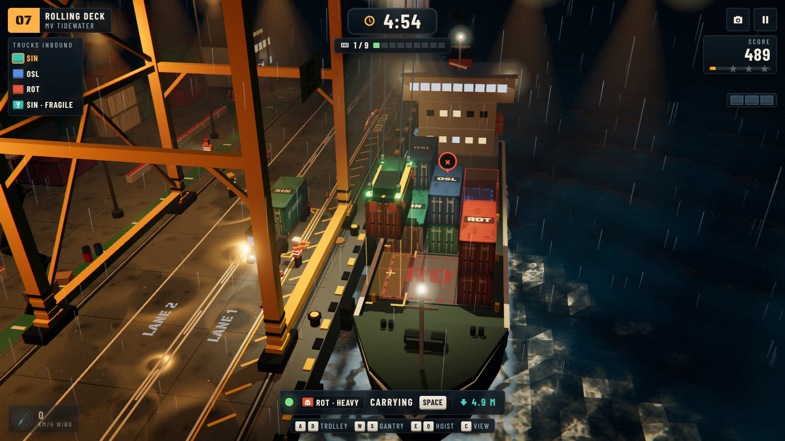
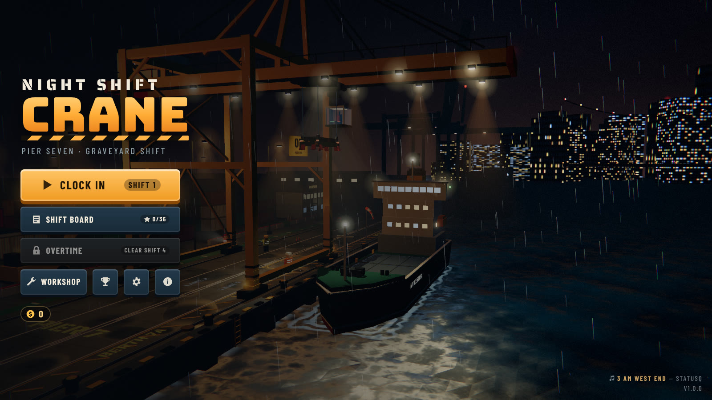

# Night Shift Crane



A 3D harbour-crane stacking game for the browser. Run ship-to-shore crane 07 through the graveyard
shift: lift containers off the trucks, fight the swing, the wind and the swell, and twist-lock them
onto a rolling ship before it sails.

- **Straight into the cab**: a first-time player loads in with a box already on the hook — the first
  thing they do is let go of it, and coins fly into the wallet. Each following box teaches one
  control in play (no cards, no tutorial chain, no tour)
- **The night shift** (main mode): endless, ship after ship. Each ship is a 60–90 second round of
  4–6 boxes and the next one comes alongside automatically. A dropped box costs its bonus and the
  combo, never the shift. Combo multiplier up to x3, every box pays straight into the wallet
- **Upgrades that change the play**: anti-sway damper, drive motors, magnet assist (auto-lock at
  level 2), wide spreader (longer flippers, more forgiving), hoist winch, overtime clause — bought
  mid-shift from the upgrade chip. The port visibly grows with everything you move
- **Reasons to come back**: one episode of the Pier Seven story a night (a black box, your choice,
  a cliffhanger), and your night crew's takings waiting when you return
- **One-touch mobile play**: drag the spreader where you want it; hoisting, lowering, locking and
  releasing happen by themselves. Works in portrait and landscape
- **Challenges**: 12 hand-made shifts (destination bays, gusts, customs spot checks, heavy / fragile /
  reefer / hazmat cargo, forty-footers, fog, power cuts, a full storm) and a generated daily shift
- Progress is saved locally and, for signed-in CrazyGames players, in the cloud
- Small first load: the physics WASM ships as a binary next to the script, sounds stream in after
  the game has started



## Play

It is a static site: open `index.html` from any web server (GitHub Pages works as-is).

```bash
npm install
npm run serve      # http://localhost:8080
```

| Action | Keyboard | Touch |
| --- | --- | --- |
| Trolley (out / in) | `A` `D` or `←` `→` | stick left / right |
| Gantry (along the quay) | `W` `S` or `↑` `↓` | stick up / down |
| Hoist / lower | `E` / `Q` | ▲ / ▼ buttons |
| Lock on / release | `Space` | round button |
| Cab view | `C` | camera button |
| Horn | `H` | — |
| Pause | `Esc` | pause button |

## Develop

Source lives in `src/` (ES modules). `build/game.js` is the committed production bundle with
three.js and the Rapier physics engine included — nothing is loaded from a CDN.

```bash
npm run build      # src/ -> build/game.js
npm run watch      # rebuilds build/game.dev.js on change (with dev hooks + source maps)
npm run serve      # local server (gzip, like a CDN) on :8080
npm run release    # prod build + release/night-shift-crane-crazygames.zip (index.html at the root)
```

`tools/make_audio.py` documents how every file in `assets/audio/` was cut from its source
recording. See [CREDITS.md](CREDITS.md) for all third-party audio, music, fonts and libraries.

## Platform

The game integrates the CrazyGames HTML5 SDK v3 (loading, gameplay start/stop, happytime, midgame
ads at natural breaks, rewarded "second chance"). Every SDK call is a safe no-op when the SDK is not
present, so the same build runs on GitHub Pages or locally.

- **Straight into play.** No title, menu or tutorial before the first box: the page boots into the
  night shift with a container on the hook. Only the code, physics (Rapier wasm) and fonts are on the
  critical path (~0.9 MB gzipped); sounds stream in afterwards, music only once the first-box sounds
  are in. Music (mono 96 kbps) streams through one `<audio>` element into the mixer, so no track is
  ever decoded into memory.
- **Controls:** mouse and touch share one scheme (drag moves the spreader, click / tap locks or lets
  go, right-drag orbits the view); keys still do everything. The canvas takes focus so keys work in
  the platform's iframe, and the first boxes show a pulsing nudge when nothing is pressed for 4 s.
- **Devices:** the platform's device type (desktop / mobile / tablet) decides the touch UI when the
  SDK provides it. Automatic quality starts at *low* on Chromebooks and machines with ≤ 4 GB or
  ≤ 4 threads and only steps up after sustained clean frames; no MSAA on low or above 1.5× DPR.
  A lost WebGL context pauses the game; if it is not back within 3 s a card offers a saved reload.
- **Saves** go to `localStorage` and, when the platform offers it, the CrazyGames data module (the
  newer copy wins). Every reward is written at once; the tab going hidden flushes too.
- **Coming back:** daily login streak (7-day ladder), the night crew's idle earnings (a non-blocking
  strip on the way in), one Pier Seven episode per day with a cliffhanger, this week's port record
  (resets Monday; the platform leaderboard is used only if the SDK has one), the daily challenge ship
  (same seed for everyone), and a "tomorrow night" teaser on the pause card and the slip. The title
  has one big *Continue shift* button; signed-in players see their name on the cab's plate.
- **SDK:** loading start/stop, gameplay start/stop around pause, menus, results and ads, happytime on
  full ships, goals and milestones, platform mute. Midgame ads only at a run's end (before the slip,
  never when it offers the second chance) and on title → new run. Rewarded features count as ads only
  after an ad has really filled in this visit; until then the second chance is free (once per run)
  and the idle-earnings doubling is not offered.
- **Analytics:** `src/core/analytics.js` sends `game_loaded`, `first_input`, `first_reward`,
  `round_complete`, `upgrade_bought`, `daily_reward_claim`, `idle_collect`, `return_day_N` and
  `session_end` (with `duration_s`) to ByteBrew when its web SDK is on the page, to
  `window.NSC_ANALYTICS(name, params)` if defined, or to sinks added with `nscAnalytics.addSink(fn)`.
  When any of these is present, new players get a small corner note linking `privacy.html`, which
  also has an opt-out switch.
